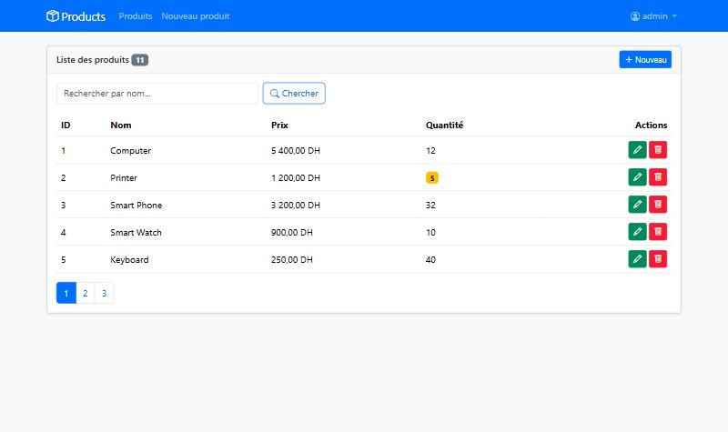
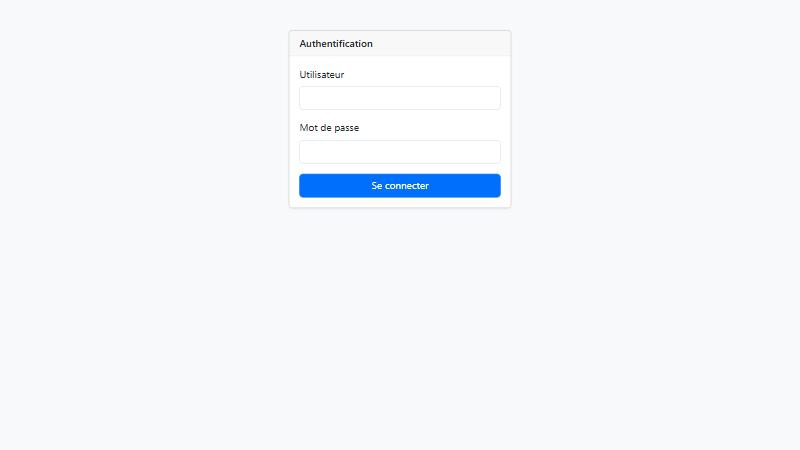

> **NOTE :** Une IA (Claude) m'a aidé à coder et à analyser ce travail.

# Compte rendu — Spring MVC, Thymeleaf et Spring Security

Application Web JEE de gestion de produits basée sur **Spring Boot**, **Spring Data JPA**, **Hibernate**,
**Thymeleaf** et **Spring Security**, en suivant la vidéo
[All In One Spring MVC Thymeleaf Spring Security](https://www.youtube.com/watch?v=FHy7raIldgg).



---

## Structure du projet

```
src/main/java/net/sofbt/products
├── SpringMvcThymeleafApplication.java   # main + données initiales (CommandLineRunner)
├── entities/Product.java                # entité JPA + contraintes de validation
├── repositories/ProductRepository.java  # interface Spring Data
├── security/SecurityConfig.java         # configuration Spring Security
└── web/ProductController.java           # contrôleur Spring MVC
src/main/resources
├── application.properties               # port, profil actif
├── application-h2.properties            # base H2 en mémoire
├── application-mysql.properties         # base MySQL
└── templates
    ├── layout1.html          # page template (Thymeleaf Layout + Bootstrap)
    ├── products.html         # liste, recherche, pagination, suppression
    ├── product-form.html     # fragment du formulaire (ajout et édition)
    ├── new-product.html      # ajout d'un produit
    ├── edit-product.html     # édition d'un produit
    ├── login.html            # page d'authentification personnalisée
    └── notAuthorized.html    # page d'accès refusé (403)
src/test/java/net/sofbt/products
└── ProductRepositoryTest.java # tests de la couche DAO (@DataJpaTest)
```

---

## 1. Création du projet Spring Boot

Projet généré avec Spring Initializr (Spring Boot 4.1.1, Java 17, Maven) :

| Dépendance | Rôle |
|---|---|
| Spring Web | Spring MVC + Tomcat embarqué |
| Spring Data JPA | JPA, Hibernate et Spring Data |
| H2 Database | Base de données en mémoire |
| MySQL Driver | Base de données MySQL (profil `mysql`) |
| Thymeleaf | Moteur de templates côté serveur |
| Lombok | Génère getters, setters, constructeurs, builder |
| Spring Security | Authentification et autorisation |
| Validation | Bean Validation (`@NotEmpty`, `@Size`, `@Min`...) |

Dépendances ajoutées à la main dans le `pom.xml` :

```xml
<dependency>  <!-- layout:decorate / layout:fragment -->
    <groupId>nz.net.ultraq.thymeleaf</groupId>
    <artifactId>thymeleaf-layout-dialect</artifactId>
    <version>3.4.0</version>
</dependency>
<dependency>  <!-- Bootstrap servi localement via /webjars/** -->
    <groupId>org.webjars</groupId>
    <artifactId>bootstrap</artifactId>
    <version>5.3.3</version>
</dependency>
<dependency>  <!-- icônes Bootstrap -->
    <groupId>org.webjars.npm</groupId>
    <artifactId>bootstrap-icons</artifactId>
    <version>1.11.3</version>
</dependency>
```

`thymeleaf-extras-springsecurity6` est ajouté automatiquement par Initializr : il fournit les attributs
`sec:authorize` et `sec:authentication` utilisés dans les vues.

## 2. Entité JPA `Product`

```java
@Entity
@Getter @Setter @NoArgsConstructor @AllArgsConstructor @Builder @ToString
public class Product {
    @Id @GeneratedValue(strategy = GenerationType.IDENTITY)
    private Long id;

    @NotEmpty(message = "Le nom est obligatoire")
    @Size(min = 3, max = 50, message = "Le nom doit contenir entre 3 et 50 caractères")
    @Column(length = 50, nullable = false)
    private String name;

    @DecimalMin(value = "0.1", message = "Le prix doit être supérieur à 0")
    private double price;

    @Min(value = 0, message = "La quantité ne peut pas être négative")
    private int quantity;
}
```

Les annotations JPA (`@Entity`, `@Id`, `@Column`) décrivent le mapping vers la table, et les annotations
de **Bean Validation** décrivent les règles que le formulaire doit respecter (utilisées à l'étape 6).

## 3. Interface `ProductRepository`

```java
public interface ProductRepository extends JpaRepository<Product, Long> {
    Page<Product> findByNameContainsIgnoreCase(String keyword, Pageable pageable);
    List<Product> findByPriceGreaterThan(double price);
}
```

Spring Data génère l'implémentation au démarrage. `findByNameContainsIgnoreCase` est traduite en
`where upper(name) like upper('%keyword%')` et renvoie une `Page` : elle sert à la fois à la **recherche**
et à la **pagination**.

## 4. Test de la couche DAO

**a. Au démarrage**, un `CommandLineRunner` insère des produits puis les consulte :

```java
@Bean
CommandLineRunner start(ProductRepository productRepository) {
    return args -> {
        productRepository.save(Product.builder().name("Computer").price(5400).quantity(12).build());
        productRepository.save(Product.builder().name("Printer").price(1200).quantity(5).build());
        // ... 11 produits au total
        productRepository.findAll().forEach(System.out::println);
        System.out.println(productRepository.findById(1L).orElseThrow());
        productRepository.findByPriceGreaterThan(2000).forEach(System.out::println);
    };
}
```

```
--- Tous les produits
Product(id=1, name=Computer, price=5400.0, quantity=12)
Product(id=2, name=Printer, price=1200.0, quantity=5)
Product(id=3, name=Smart Phone, price=3200.0, quantity=32)
...
Product(id=11, name=Tablet, price=2700.0, quantity=9)
--- Produit id=1
Product(id=1, name=Computer, price=5400.0, quantity=12)
--- Produits dont le prix > 2000
Product(id=1, name=Computer, price=5400.0, quantity=12)
Product(id=3, name=Smart Phone, price=3200.0, quantity=32)
Product(id=11, name=Tablet, price=2700.0, quantity=9)
```

**b. Tests unitaires** avec `@DataJpaTest` (base H2, chaque test est annulé par un rollback) :

```java
@DataJpaTest
class ProductRepositoryTest {
    @Autowired
    private ProductRepository productRepository;

    @Test
    void saveFindUpdateDelete() {
        Product saved = productRepository.save(Product.builder().name("Laptop").price(9000).quantity(3).build());
        assertThat(saved.getId()).isNotNull();
        // findById, mise à jour du prix, deleteById ...
    }

    @Test
    void searchByNameWithPagination() {
        // 2 produits "Smart..." sur 3, page de taille 1 -> 2 pages
        Page<Product> page = productRepository.findByNameContainsIgnoreCase("smart", PageRequest.of(0, 1));
        assertThat(page.getTotalElements()).isEqualTo(2);
        assertThat(page.getTotalPages()).isEqualTo(2);
    }
}
```

```
Tests run: 3, Failures: 0, Errors: 0, Skipped: 0
BUILD SUCCESS
```

## 5. Désactiver la protection par défaut de Spring Security

Dès que `spring-boot-starter-security` est dans le classpath, **toutes** les URLs sont protégées par un
formulaire de login généré, avec un utilisateur `user` et un mot de passe aléatoire affiché dans la console.
Pour développer la partie MVC sans être bloqué, on désactive temporairement cette configuration
automatique :

```java
@SpringBootApplication(exclude = {SecurityAutoConfiguration.class})
public class SpringMvcThymeleafApplication { ... }
```

Une fois la partie MVC terminée, l'exclusion est retirée et remplacée par notre propre configuration
(étape 7).

## 6. Contrôleur Spring MVC et vues Thymeleaf

### Page template (Thymeleaf Layout + Bootstrap)

[`layout1.html`](src/main/resources/templates/layout1.html) contient la structure commune (navbar,
messages, Bootstrap). Chaque page ne définit que sa zone `content` :

```html
<!-- layout1.html -->
<nav class="navbar navbar-expand-sm navbar-dark bg-primary"> ... </nav>
<main class="container py-4">
    <section layout:fragment="content"></section>
</main>

<!-- products.html -->
<html layout:decorate="~{layout1}">
<section layout:fragment="content"> ... </section>
```

### Afficher la liste des produits

```java
@GetMapping("/user/index")
public String index(Model model,
                    @RequestParam(name = "keyword", defaultValue = "") String keyword,
                    @RequestParam(name = "page", defaultValue = "0") int page,
                    @RequestParam(name = "size", defaultValue = "5") int size) {
    Page<Product> products = productRepository.findByNameContainsIgnoreCase(
            keyword, PageRequest.of(page, size, Sort.by("id")));
    model.addAttribute("products", products.getContent());
    model.addAttribute("pages", new int[products.getTotalPages()]);
    model.addAttribute("currentPage", page);
    model.addAttribute("keyword", keyword);
    return "products";
}
```

```html
<tr th:each="p : ${products}">
    <td th:text="${p.id}"></td>
    <td th:text="${p.name}"></td>
    <td th:text="${#numbers.formatDecimal(p.price, 1, 'WHITESPACE', 2, 'COMMA')} + ' DH'"></td>
    <td th:text="${p.quantity}"></td>
</tr>
```

### Supprimer un produit

La suppression modifie les données : elle se fait donc en **POST** (et non par un simple lien GET), ce qui
permet aussi à Spring Security de vérifier le jeton **CSRF** ajouté automatiquement par `th:action`.

```html
<form method="post" th:action="@{/admin/delete}"
      onsubmit="return confirm('Voulez-vous vraiment supprimer ce produit ?')">
    <input type="hidden" name="id" th:value="${p.id}">
    <button type="submit" class="btn btn-sm btn-danger"><i class="bi bi-trash"></i></button>
</form>
```

```java
@PostMapping("/admin/delete")
public String delete(@RequestParam Long id, @RequestParam(defaultValue = "") String keyword,
                     @RequestParam(defaultValue = "0") int page, RedirectAttributes ra) {
    productRepository.deleteById(id);
    ra.addFlashAttribute("message", "Produit supprimé avec succès");
    ra.addAttribute("keyword", keyword);
    ra.addAttribute("page", page);
    return "redirect:/user/index";   // on reste sur la même page de résultats
}
```

### Saisir et ajouter un produit avec validation

```html
<form method="post" th:action="@{/admin/saveProduct}" th:object="${product}">
    <input type="hidden" th:field="*{id}">
    <input type="text" class="form-control" th:field="*{name}" th:errorclass="is-invalid">
    <div class="invalid-feedback" th:errors="*{name}"></div>
    ...
</form>
```

```java
@PostMapping("/admin/saveProduct")
public String saveProduct(@Valid Product product, BindingResult bindingResult, RedirectAttributes ra) {
    if (bindingResult.hasErrors()) {
        return product.getId() == null ? "new-product" : "edit-product";
    }
    productRepository.save(product);
    ra.addFlashAttribute("message", "Produit ajouté avec succès");
    return "redirect:/user/index";
}
```

- `@Valid` déclenche la vérification des contraintes de l'entité ;
- `BindingResult` contient les erreurs : si il y en a, on réaffiche le formulaire avec les valeurs saisies ;
- `th:errorclass="is-invalid"` + `th:errors` affichent le champ en rouge avec son message.

Exemple : envoi de `name=ab`, `price=-5`, `quantity=-1` →

```
Le nom doit contenir entre 3 et 50 caractères
Le prix doit être supérieur à 0
La quantité ne peut pas être négative
```

Après l'enregistrement, on fait un **redirect** (pattern Post/Redirect/Get) : un rafraîchissement de la page
ne renvoie pas le formulaire une deuxième fois.

## 7. Sécurisation avec Spring Security

[`SecurityConfig`](src/main/java/net/sofbt/products/security/SecurityConfig.java) :

```java
@Configuration
@EnableWebSecurity
@EnableMethodSecurity
public class SecurityConfig {

    @Bean
    public PasswordEncoder passwordEncoder() {
        return new BCryptPasswordEncoder();
    }

    @Bean
    public InMemoryUserDetailsManager inMemoryUserDetailsManager(PasswordEncoder passwordEncoder) {
        return new InMemoryUserDetailsManager(
            User.withUsername("user1").password(passwordEncoder.encode("1234")).roles("USER").build(),
            User.withUsername("user2").password(passwordEncoder.encode("1234")).roles("USER").build(),
            User.withUsername("admin").password(passwordEncoder.encode("1234")).roles("USER", "ADMIN").build()
        );
    }

    @Bean
    public SecurityFilterChain securityFilterChain(HttpSecurity http) throws Exception {
        return http
            .formLogin(form -> form.loginPage("/login").defaultSuccessUrl("/user/index", true).permitAll())
            .logout(logout -> logout.logoutSuccessUrl("/login?logout").permitAll())
            .authorizeHttpRequests(auth -> auth
                .requestMatchers("/webjars/**").permitAll()
                .requestMatchers("/admin/**").hasRole("ADMIN")
                .requestMatchers("/user/**").hasRole("USER")
                .anyRequest().authenticated())
            .exceptionHandling(ex -> ex.accessDeniedPage("/notAuthorized"))
            .build();
    }
}
```

| Élément | Rôle |
|---|---|
| `InMemoryUserDetailsManager` | utilisateurs stockés en mémoire |
| `BCryptPasswordEncoder` | les mots de passe sont stockés hachés, jamais en clair |
| `formLogin().loginPage("/login")` | page de login personnalisée ([`login.html`](src/main/resources/templates/login.html)) |
| `/admin/**` → `ADMIN`, `/user/**` → `USER` | autorisation par URL |
| `@PreAuthorize("hasRole('ADMIN')")` | autorisation au niveau des méthodes du contrôleur (`@EnableMethodSecurity`) |
| `accessDeniedPage("/notAuthorized")` | page affichée en cas d'erreur 403 |
| CSRF (actif par défaut) | chaque formulaire POST contient un jeton `_csrf` ajouté par `th:action` |

Dans les vues, l'affichage dépend du rôle :

```html
<a sec:authorize="hasRole('ADMIN')" th:href="@{/admin/newProduct}">Nouveau</a>
<span sec:authentication="name"></span>   <!-- nom de l'utilisateur connecté -->
```



| Utilisateur | Mot de passe | Rôles | Droits |
|---|---|---|---|
| `user1`, `user2` | `1234` | USER | consulter et rechercher |
| `admin` | `1234` | USER, ADMIN | + ajouter, modifier, supprimer |

## 8. Fonctionnalités supplémentaires

| Fonctionnalité | Réalisation |
|---|---|
| **Recherche** | champ `keyword` → `findByNameContainsIgnoreCase` (insensible à la casse) |
| **Édition / mise à jour** | `GET /admin/editProduct?id=..` pré-remplit le formulaire ; le champ caché `id` fait que `save()` exécute un `UPDATE` au lieu d'un `INSERT` |
| **Pagination** | `PageRequest.of(page, 5)` + barre de pages Bootstrap qui conserve le mot-clé |
| Formulaire réutilisable | fragment [`product-form.html`](src/main/resources/templates/product-form.html) partagé par l'ajout et l'édition |
| Confirmation de suppression | `confirm()` JavaScript avant l'envoi |
| Messages flash | « Produit ajouté / mis à jour / supprimé avec succès » via `RedirectAttributes` |
| Stock faible | badge orange si la quantité est < 10 |
| Page 403 | [`notAuthorized.html`](src/main/resources/templates/notAuthorized.html) |
| Déconnexion | menu utilisateur dans la navbar (POST `/logout`) |
| Profil MySQL | `application-mysql.properties`, activable sans modifier le code |

## Vérification

Scénario testé sur l'application lancée :

| Action | Résultat |
|---|---|
| `GET /user/index` sans être connecté | 302 → `/login` |
| login `admin` / `1234` | 302 → `/user/index`, 11 produits sur 3 pages |
| recherche `smart` | Smart Phone, Smart Watch |
| ajout invalide (`ab`, `-5`, `-1`) | formulaire réaffiché avec les 3 messages d'erreur |
| ajout « Gaming Chair » | produit n°12 créé |
| édition du produit 2 → « Printer HP », 1350 | produit mis à jour |
| suppression du produit 3 | produit supprimé, retour à la même page |
| login `user1` puis `GET /admin/newProduct` | **403** → page « Accès refusé », aucun bouton modifier/supprimer |

---

## Lancer le projet

Prérequis : JDK 17+.

```bash
./mvnw spring-boot:run
```

Puis ouvrir http://localhost:8094 et se connecter avec `admin` / `1234`.

Pour utiliser MySQL :

```bash
./mvnw spring-boot:run -Dspring-boot.run.profiles=mysql
```

## Conclusion

Spring MVC sépare clairement les responsabilités : le **contrôleur** reçoit la requête, interroge la
couche DAO (**Spring Data JPA**) et place les données dans le `Model` ; la **vue Thymeleaf** les affiche
côté serveur. Le **Layout Dialect** évite de dupliquer la structure des pages, et **Bean Validation**
centralise les règles de saisie dans l'entité. Enfin, **Spring Security** protège l'application par
authentification (login, mots de passe hachés BCrypt) et par autorisation (rôles sur les URLs, sur les
méthodes et dans les vues), avec la protection CSRF activée sur tous les formulaires.
